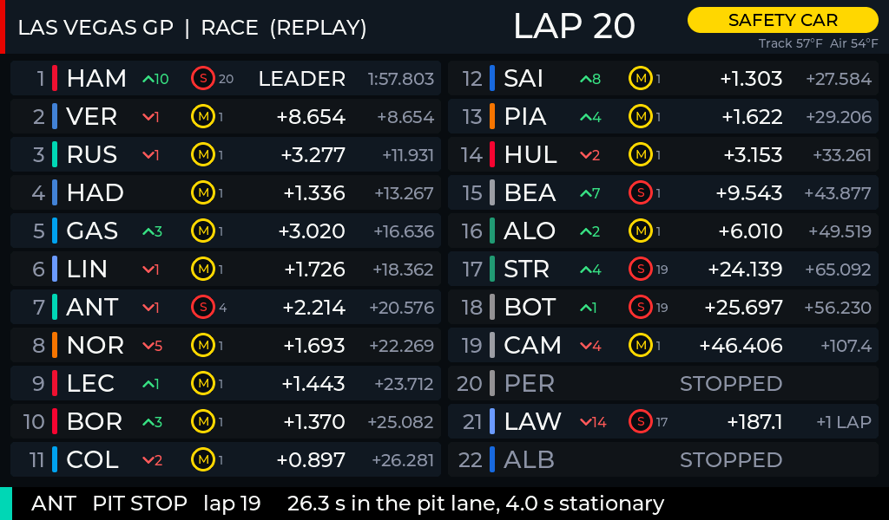
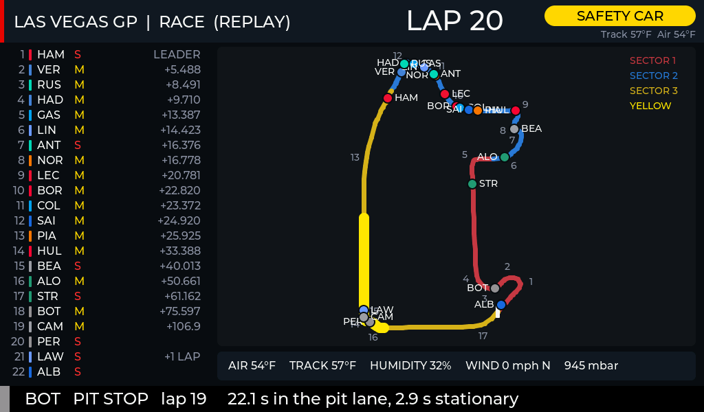
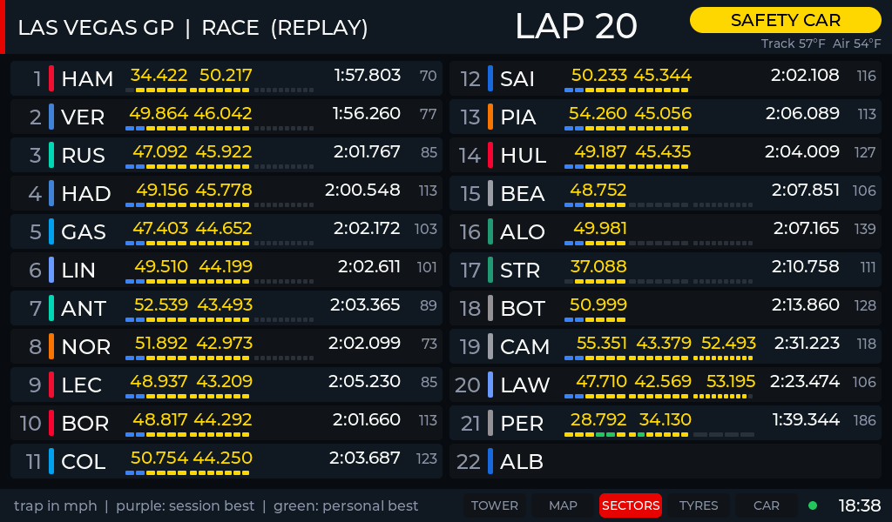
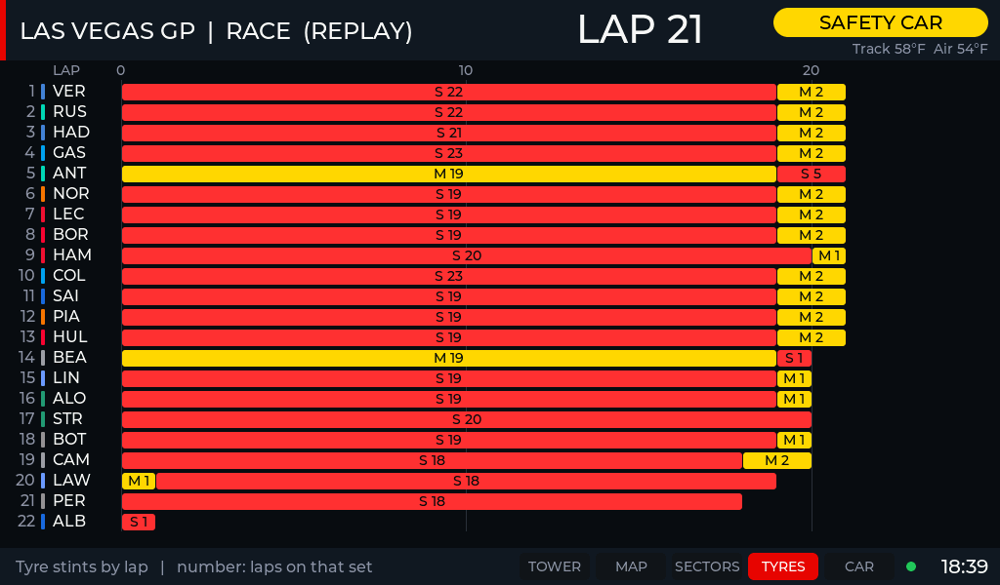
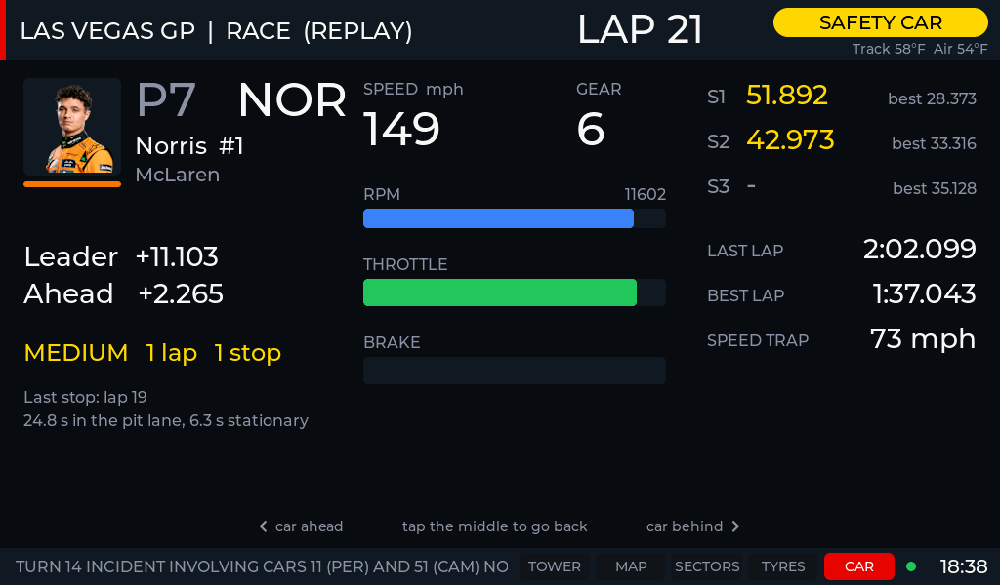
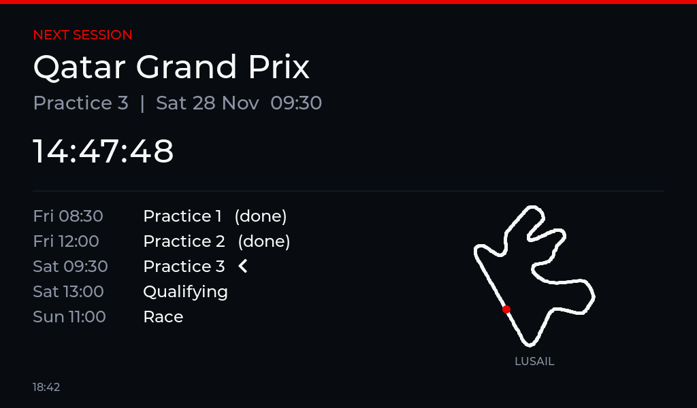
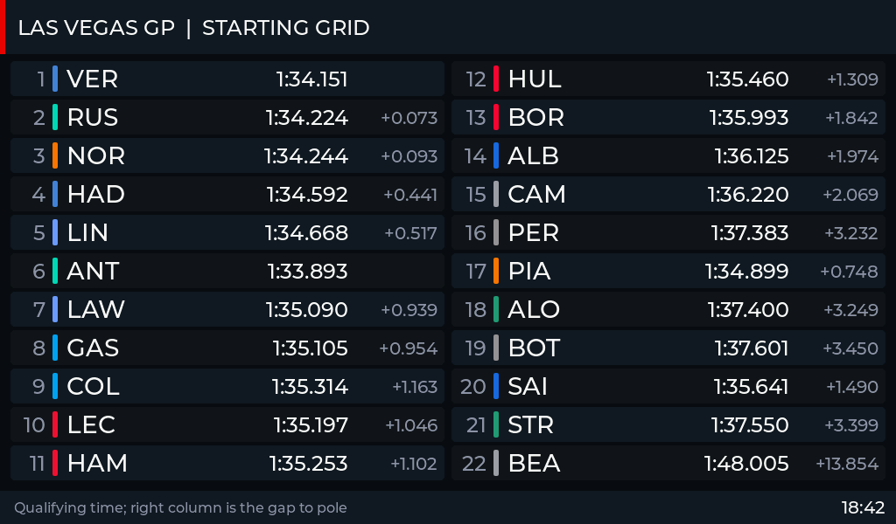
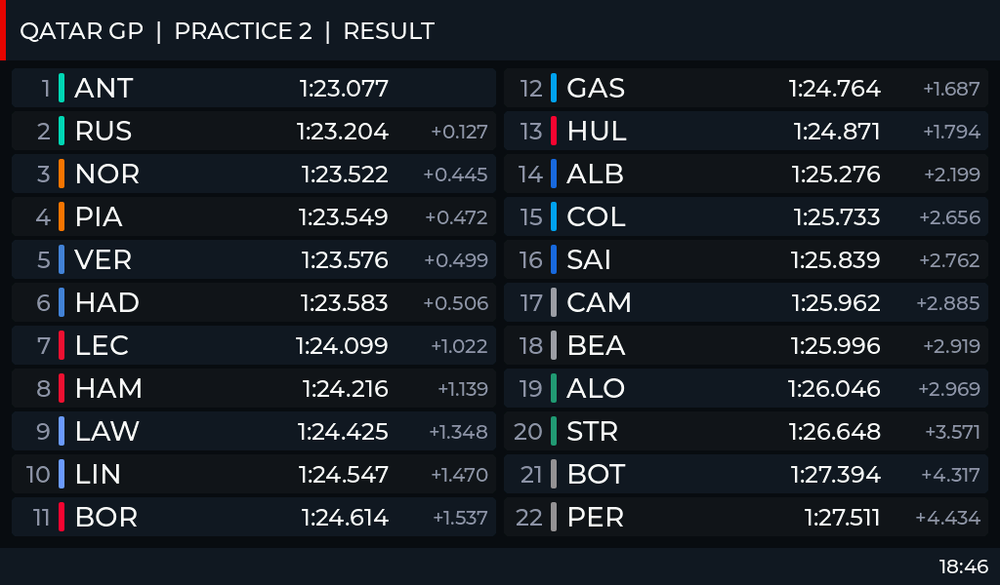
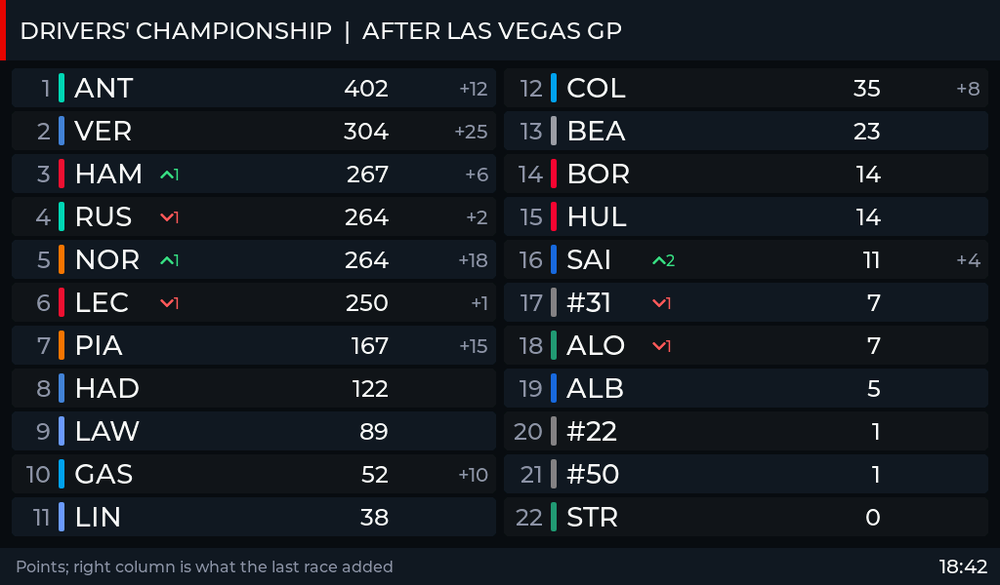
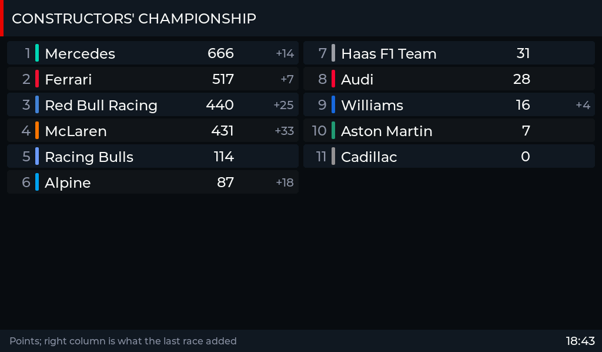

# Darkside F1 P4

A personal Formula 1 live-timing display for the **Elecrow CrowPanel Advanced
10.1" ESP32-P4** (1024x600 EK79007 MIPI-DSI, GT911 touch, ESP32-C6 radio),
fed by the [OpenF1 API](https://openf1.org). Inspired by the Petrol Vibes
Race Display; not affiliated with it, OpenF1, or Formula 1.

## What it shows

- **Race:** running order in team colours, gap to the car ahead and to the
  leader, places gained/lost since the grid, tyre compound and age, lap
  counter, track status, newest race-control message.
- **Practice / qualifying:** best laps and gaps; in qualifying the current
  segment (Q1-Q3), with knocked-out drivers dimmed.
- **More live screens** (tabs along the bottom: TOWER, MAP, SECTORS, TYRES,
  CAR; tap a driver's row for that car, tap the middle of the car screen to
  go back): the circuit coloured by sector, with corner numbers, every car
  on it, any marshal sector under a yellow flag drawn as a wide yellow
  band, and the weather; sector times, mini-sectors, last lap and speed
  trap for the field; the tyre strategy (one bar per set of tyres along the
  laps, with the compound and the laps on that set); one car's speed, gear,
  RPM, throttle and brake with its sectors, pit-stop times and portrait.
  Speeds are in mph and temperatures in Fahrenheit (`SPEED_MPH`,
  `TEMP_FAHRENHEIT` in config.h). Corner numbers and marshal sectors come
  from the circuit file OpenF1's meetings point to (MultiViewer).
- **Alerts:** full-screen for lights out, Safety Car, VSC, red flag, green
  flag and the chequered flag (winner + top 5). Along the bottom: top-10
  overtakes (pit-stop position changes are filtered out), pit stops with
  pit-lane and stationary time, team radio, fastest lap.
- **Between sessions** (stays on one screen, tap for the next; `IDLE_ROTATE_S`
  in config.h brings back an automatic change every so many seconds):
  countdown to the next session with the weekend timetable in local time
  and an outline of the circuit (traced from one car's lap via `/location`),
  the starting grid once qualifying has set it, last session result,
  drivers' and constructors' standings.

It switches to the live screen 15 minutes before a session and back
afterwards on its own.

## Screens

Taken from the panel's own framebuffer over serial (`tools/serial_hub.py`):
the live screens during a replay of the 2026 Las Vegas race under the
safety car, the others between sessions.

| | |
|---|---|
|  **Tower** - order, places gained or lost, tyres, gaps; a pit-stop strip along the bottom |  **Map** - sectors by colour, corner numbers, cars, a marshal sector under yellow |
|  **Sectors** - sector times, mini-sectors, last lap, speed trap |  **Tyres** - every set of tyres along the laps |
|  **Car** - speed, gear, RPM, throttle, brake, sectors, last pit stop |  **Alert** - full screen for a few seconds (here the safety car) |
|  **Next session** - countdown, weekend timetable, circuit outline |  **Starting grid** - once qualifying has set it |
|  **Last result** |  **Drivers' championship** |
|  **Constructors' championship** | |

## Setup

1. `cp secrets.h.example secrets.h` and fill in Wi-Fi.
2. **Live timing needs a paid OpenF1 account** — put its username and
   password in `secrets.h`. Without one, everything between sessions works
   and the live screen says a login is needed. With one, live data is
   pushed over OpenF1's MQTT stream, with REST polling as the fallback.
3. No account or no race on? Set `REPLAY_SESSION_KEY` in `secrets.h` (e.g.
   `11420`, the 2026 Las Vegas race) to play a past session through the live
   screens using free data.
4. `./build.sh flash` (arduino-cli, esp32 core 3.3.11, library
   ESP32_Display_Panel 1.0.4 with its two dependencies installed globally;
   LVGL 8.3.11 and ArduinoJson are vendored in `lib/`).

Other settings (time zone, stream delay to match a delayed TV feed, poll
rates, brightness) are in `config.h`.

## First flash — things to check

Run on a real panel since 2026-11-27 (see `CLAUDE.md` for what has and
has not been checked on hardware).

- Blank screen: the display setup is Elecrow's own Lesson09 config,
  unchanged. Confirm their example runs on your board revision first.
- Wi-Fi never connects: see the `C6_RESET` note in `config.h`; and the C6
  must carry esp-hosted firmware that matches the core (Elecrow ship an
  updater in their repo).
- OpenF1 allows 6 requests/second and 60/minute. The firmware polls at 46
  per minute in a race and hard-caps itself at 50 (`API_MAX_PER_MIN`). A
  429 in the serial log pauses requests for 30 s; it should only appear if
  something else is using the same account.

## Not included

OpenF1 has no lap records, previous winners, race distance (so the lap
counter has no "/ 57"), weather forecast or "on this day" items. Team
radio is announced, not played.

Without an OpenF1 login the whole API (past sessions too) answers 401
while any F1 session is running, so replay mode and the between-session
screens stop updating until it ends.

## Layout

| File | Role |
|---|---|
| `DarksideF1P4.ino` | board bring-up, Wi-Fi, clock |
| `f1_model.*` | race state from API responses (portable C++) |
| `f1_api.*` | HTTPS + OpenF1 token |
| `f1_mqtt.*` | live stream (MQTT over TLS) |
| `f1_head.*` | driver portraits (PNG to LVGL pixels) |
| `f1_app.*` | network task: calendar, live stream + polling, idle data |
| `ui.*` | LVGL screens |
| `esp_panel_*`, `board_config.h`, `lvgl_v8_port.*` | from Elecrow's example |
| `tools/host_test.cc`, `tools/sim/`, `tools/fetch_samples.sh` | desktop tests: model replay and screen renders |
| `tools/serial_hub.py`, `tools/mqtt_bench.py` | bench: serial log + screenshots; a recorded session served as an MQTT stream |
| `CLAUDE.md` | working notes: hardware findings, bench tools, what has been checked on the panel |
| `docs/screens/` | the screenshots above |
